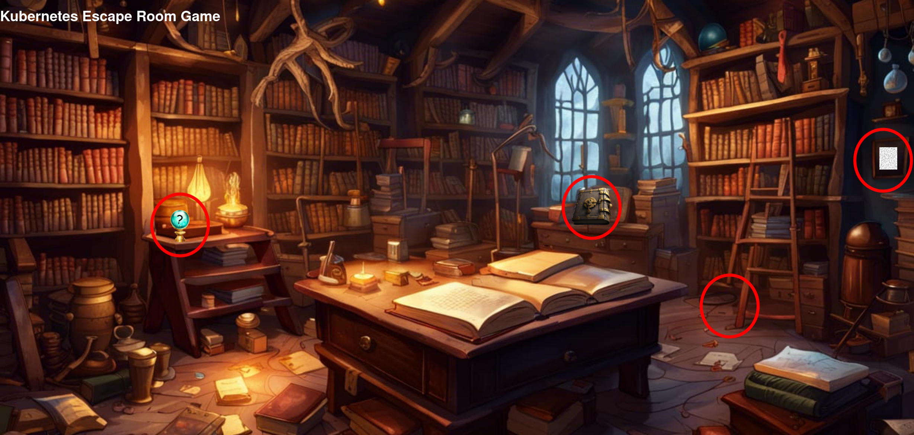

# Kubernetes Escape Room Game

You are a wizard apprentice. While your teacher is out of house you decided to sneak into his study to practice some spells. 
Maybe try out some magic artifacts you find there. 
But while reciting an incantation you found in a hidden tome something went horribly wrong. 
Important things are missing or not working anymore. It is now on you to fix what has been broken.

**Broken parts in the study are marked with a red circle. 
Hovering there with your cursor gives you a hint for what you might be looking for.**

## Inspired By
[The Great Escape](https://github.com/t-gmn/the-great-escape)

## Pictures
All pictures were AI-generated with [NightCafé](https://creator.nightcafe.studio/) and are provided as-is, without warranty of copyright ownership or non-infringement.

## License and credits
This project is licensed under the [Apache License 2.0](LICENSE). See [CREDITS.md](CREDITS.md) for third-party material, image terms and trademark notes.

## Usage

[Github codespaces](.docs/codespaces.md)

[Local](.docs/local.md)

## Get started
Regardless of execution environment, there are certain tools you can use to interact with the escape room.
Once you are in the workbench and have initialized the cluster with `. init.sh`, you can use [k9s](https://k9scli.io/) to see cluster resources in the terminal.
You can also use [kubectl](https://kubernetes.io/docs/reference/kubectl/).

### Note
Tooltip hints are available when hovering with the cursor over the red circles. Note that in the firefox browser the tooltip hints only appear when the browser window is focused.
Please use another browser or keep in mind to focus the browser window for tooltips when using firefox.

